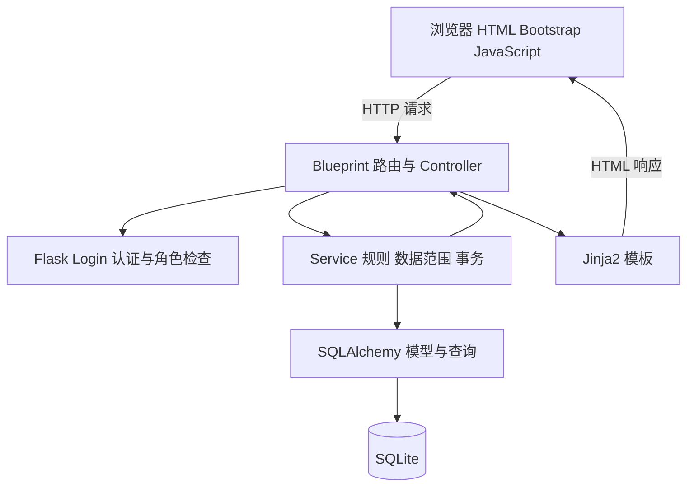

# 学生综合信息管理系统架构设计

版本 0.7。管理员账号及审计、三角色统计与导航已实施。

依据原案第 3 章、阶段 1 至 8 和附录 A。本文与 [需求](requirements.md)、[数据库](database_design.md)、[假设登记](assumptions.md) 共用术语；权限以需求矩阵为准。原案链接和源文件指纹见 [审查报告](design_review_report.md)。

## 1 架构边界与技术栈

采用 B/S、服务端 Jinja2 页面渲染及 Flask 分层架构，不增加独立前端应用、微服务、外部通知服务或新的数据库。以下是原案已选择的方案；阶段 0 无须另行扩展架构选型。

| 层次或能力 | 原案选型 | 职责 |
| --- | --- | --- |
| 浏览器表现 | HTML5、CSS3、Bootstrap 5、JavaScript | 导航、表单、表格、反馈；客户端校验只辅助体验 |
| 页面模板 | Jinja2 | 服务端生成页面 |
| Web 应用 | Python 3、Flask、create_app、Blueprint | 路由、请求解析、响应组织 |
| 会话与密码 | Flask-Login、Werkzeug | 登录会话及安全密码哈希 |
| 业务服务 | Python Service 层 | 规则、授权范围、关联校验、事务组织、聚合口径 |
| ORM | Flask-SQLAlchemy、SQLAlchemy | 持久化实体、关系、参数化查询、约束 |
| 存储 | SQLite | `instance/student_management.db` |
| 测试 | pytest、Flask test_client | 业务单测、路由集成、数据库与权限测试 |
| CSRF | Flask-WTF（用户阶段 1 指定） | 状态变更防护，不等同于已实现登录和 RBAC |
| 图表 | Chart.js 可选 | 只展示已有统计，不扩大 BI 范围 |
| 迁移 | Flask-Migrate / Alembic（阶段 2 指定） | 显式升级结构、初始 revision、结构对照；工厂不建表 |

使用项目 .venv 的 Python 3.12.10 与 requirements.txt 固定依赖。阶段 2 通过迁移显式建表；create_app 和模块 import 不创建表或业务数据。UTC naive 时间和本阶段结构扩展依据 [阶段 2 决策](stage2_decisions.md)。

## 2 层次和依赖方向



Controller、StudentService、ORM 等是**设计职责名**，尚非实际存在的 Python 类或方法。不因原案通信图写有 StudentRepository 就增加必需的 Repository 层；由 Service 使用 ORM 即满足原案。

| 职责 | 应承担 | 不应承担 |
| --- | --- | --- |
| create_app 与 extensions | 加载配置、初始化扩展、注册 Blueprint 和错误处理 | 连接时自动生产业务数据 |
| 路由或 Controller | 登录、角色、CSRF 检查；解析请求；调用服务；选择页面或响应 | 写成绩公式、直接信任客户端角色及 student_id |
| Service | 校验调用者及对象范围；白名单字段；关联一致性；集中规则；组织事务 | 信任菜单隐藏产生的“权限” |
| ORM 模型 | 字段、关系、数据库约束；按授权范围构造查询 | 把可调业务策略硬编码成散落的模型方法 |
| 模板与浏览器 | 显示允许的操作、结果及错误 | 决定最终权限或产生可直接入库的总分 |

原案类图中的 login、manageClass、calculateTotal 等方法是概念行为；持久化类图列实体及字段。认证与密码管理已在阶段3实现；阶段4A已实施常规学籍转换和档案操作，阶段 5 在 grade_service 实施成绩计算，例外学籍纠错仍待后续。User 不是 Teacher 或 Student 的继承父类；它们通过可选唯一外键关联。

## 3 模块划分

| Blueprint 或目录 | 主要内容 | 服务与对象 | 对应需求 |
| --- | --- | --- | --- |
| auth | 登录、退出、本人密码 | 认证服务、User、Role | FR-01、FR-04 |
| admin | 用户角色、账号关联、停用、管理员重置密码 | 用户管理服务、User、Role | FR-02、FR-03、FR-25 |
| students | 学生、班级、教师、家长档案 | 档案服务、Student、SchoolClass、Teacher、Parent | FR-05 至 FR-08 |
| academics | 课程、选课、成绩 | 课程与成绩服务、Course、Enrollment | FR-09 至 FR-13 |
| attendance | 考勤登记、编辑、查询、统计 | 考勤服务、AttendanceRecord | FR-14 至 FR-16 |
| records | 奖惩与家长联系、模拟通知入口 | 记录服务、RewardRecord、ParentContactLog | FR-17 至 FR-22 |
| dashboard | 按角色和范围聚合 | 统计服务，复用已有对象 | FR-23、FR-24 |
| services | 验证/审计/模拟通知、权限/密码及四类档案服务 | data_validation_service、audit_service、permission_service、student/teacher/class/parent_service等 | 阶段4A管理员档案，阶段4B教师按关系限制查询和有限编辑 |

保留 11 张核心表，阶段 2 按用户指令增加 audit_logs 和 notification_logs 两个辅助表，共 13 张领域表；统计仍是聚合查询。角色字典不演化为自定义权限平台。

## 4 后续建议目录

下列为原案目录规范。阶段 2 已实施模型、辅助服务与迁移；阶段3扩展认证及最小资料；阶段 4A 在 admin 模块增加四类基础档案。阶段 5 学业模块的实际目录和路径见第 14 节。项目根即 `F:\StudentManagementSystem`。

```text
StudentManagementSystem/
  app/
    __init__.py                 # create_app
    extensions.py               # db、login_manager、csrf 等
    models/
    auth/
    students/                   # 含班级、教师、家长档案
    academics/
    attendance/
    records/
    admin/
    dashboard/
    services/                   # student_service 等职责
    templates/
    static/
  tests/
  migrations/                   # 阶段 2 初始 Alembic revision
  instance/
    student_management.db
  docs/
    specs/                      # Markdown 设计基线
      source/                   # 阶段 1 安全迁移后的 Word 原件
    uml/                        # 7 类 PlantUML 源文件
  config.py
  requirements.txt
  run.py
  README.md
```

## 5 请求与事务处理

1. 浏览器发起 HTTP 请求；路由检验会话、账号有效性、角色与写请求 CSRF。
2. 路由解析参数，调用对应 Service。当前登录 User 是授权依据；表单 user_id、teacher_id、recorded_by、created_by 不作为可信调用者。
3. Service 校验白名单字段、格式、业务规则、目标范围和关联对象。查询须在返回数据和聚合前限制范围；后端不得仅对页面按钮做限制。
4. ORM 读取关联记录及唯一性；写操作在同一业务事务中完成。最外层编排方统一提交与回滚：阶段3密码操作由路由负责，password_service与audit_service均不commit；后续业务可在最外层Service编排，但不得多处分别提交半个业务操作。
5. 唯一性预检查不能替代数据库约束；并发冲突或数据库错误须回滚。提交成功后才能反馈成功。
6. 路由根据服务结果渲染页面或返回约定响应。主交付是 HTML 页面；JSON、具体端点和错误码细节在后续路由设计中统一，不增加独立 API 平台。

新增学生的原设计顺序图、通信图、活动图使用同一过程：身份和权限检查 → 输入及班级校验 → 学号查询 → 事务插入 → 提交或回滚 → 页面反馈。通信图的编号与顺序图一致，不强行复制原案两幅图互不一致的消息编号。

## 6 权限和数据完整性落点

教师“负责班级”可由班主任外键表达，“负责课程”由授课教师外键表达；细节未定不等于全校可读。成绩写入始终要求本人负责课程；学生读操作始终固定为账号关联的 student_id。家长及联系操作还要验证 Parent.student_id 与目标学生一致。

所有业务记录中的登记人、创建人取当前 User 主键，不能把 Teacher.teacher_id 填进 users 外键。Role 与档案一致性在用户服务中检查；涉及角色表的跨表条件不假装成普通单表 CHECK。

数据库应启用 SQLite 外键检查；成绩范围、选课和考勤组合唯一性由数据库兜底。引用历史记录的对象不得无提示级联删除。空值、归档字段、指定枚举和RESTRICT已由阶段2决定；教师跨学期历史访问和其余字典仍按 A-10/A-14/A-21 待决。

## 7 规则集中管理

| 规则 | 设计落点 | 状态 |
| --- | --- | --- |
| 30/70 总分、四舍五入两位 | grade_service 使用 Decimal 计算，表单只接收两项分数 | 阶段 5 冻结 A-02、A-06 |
| 学籍与档案归档 | Student.status + is_archived | 阶段4A已实现常规五条迁移及独立归档恢复；例外纠错后续决定 |
| 教师及学生数据范围 | permission_service 按动作生成对象 SQL 条件 | 4B 档案与身份名单继续有效，阶段 5 按 A-10、A-22 授权学业操作 |
| 出勤率和成绩平均分 | attendance_service 共用考勤率计算，dashboard_statistics_service 按角色聚合 | A-03 及阶段 7 的 A-15 |
| 模拟通知状态与快照 | parent_contact_service 调用现有 notification_service | 显式模拟操作创建 NotificationLog，状态 simulated，并保存接收对象快照 |
| 写操作审计 | audit_service 追加，audit_query_service 只读取许可展示字段 | 业务与审计同事务，管理员独享查询 |

## 8 原案接口建议的解读（历史，实际地址见第12节）

保留原案附录 A.3 的方向；路径为后续设计建议，不表示阶段 0 已有可用接口。多个 HTTP 方法必须分别授权。

| 建议入口 | 设计权限 |
| --- | --- |
| GET、POST /login | 匿名可进入登录；停用账号不能成功认证 |
| POST /logout | 已登录用户 |
| GET /students | 管理员全局，教师受限；学生通过本人入口 |
| POST /students | 仅管理员（修正原案合并行可能导致教师新增的歧义） |
| GET /students/<id> | 管理员、授权教师、本人学生；后两者必须限制对象 |
| POST /students/<id>/edit | 管理员；教师字段写权待 A-05，不对学生开放 |
| GET、POST /courses | 管理员；教师课程只读和学生本人课程入口另按范围设计 |
| POST /enrollments | 管理员、授权教师（A-22） |
| POST /grades/<id> | 管理员、该课程授课教师；id 指 Enrollment 主键 |
| POST /attendance | 管理员、负责班级教师；课程教师扩展待 A-04 |
| POST /rewards | 管理员、授权教师 |
| POST /parent-contacts | 管理员、授权教师；学生与家长一致 |
| GET /dashboard | 三角色分别过滤范围 |

## 9 分阶段衔接

阶段 0 只完成审查、Markdown 与 UML。原案阶段 1 是配置、应用工厂、空 Blueprint、错误页、基础模板和健康检查；阶段 2 才实现模型与初始化；阶段 3 认证 RBAC；阶段 4 档案；阶段 5 课程成绩；阶段 6 考勤奖惩联系；阶段 7 首页及界面；阶段 8 实测部署；阶段 9 报告演示。

原案日历是开发计划而非自动执行授权。本阶段结束后等待用户下一阶段指令。开始受影响模型或业务前，先解决 [假设登记](assumptions.md) 标注的阻断项；不得把本阶段文档验证写成 Flask 功能验收通过。

## 10 阶段 2 数据层落点（历史）

app/models 按实体文件定义并统一导出 13 模型。用户档案、家长归属和分数校验由 data_validation_service 提供，ORM flush 前复核；SQLite 对家长归属及审计更新删除提供触发器兜底。全部 FK 为 RESTRICT，父端关系无历史删除级联。SQLite 每连接开启 foreign_keys。

审计四辅助函数只 add，不执行实际归档/状态变更、不 commit；通知辅助函数只记录 simulated，保存接收对象快照，无网络发送。调用方统一提交业务及审计，失败回滚。审计没有公开查询入口，未来只允许管理员授权查询。

Flask-Migrate 在工厂中初始化并发现完整 metadata；seed-roles、create-admin、seed-demo 是显式事务 CLI。create-admin 隐藏密码并确认，使用 Werkzeug 哈希；seed-demo 需要既有管理员，不创建默认账号。13 领域表另加 Alembic 版本跟踪表，不能将版本表当第 14 个业务实体。

## 11 阶段 3 认证落点（历史）

User 复用原有8字段，通过 Flask-Login 协议提供get_id/is_authenticated/is_anonymous；is_active仍为原数据库字段。auth/session.py集中加载、绝对时限、凭据HMAC版本与安全next；auth/routes.py处理登录/POST退出/改密，forms.py服务端验证真实CSRF表单。工厂启用真实current_user上下文，初始化不建表。

permission_service.py提供role_required(*roles)、has_role及学生对象读授权，教师范围未确认前拒绝。dashboard分流角色工作台、展示本人资料；students最小只读示例先授权再查记录。academics/attendance/records仍无业务路由。管理员密码重置从用户名查找表单进入目标表单，先验证管理员密码，不提供账号列表或其他CRUD。

password_service.py只更新密码哈希并add现有update审计；路由统一commit/rollback，异常仅记录固定事件，不输出SQL参数。登录/失败/退出使用无凭据安全日志，不更改数据库审计action枚举。production配置要求环境密钥并启用Secure Cookie；开发HTTP和测试独立配置保持。

原架构的/auth/login是建议地址，与阶段1保留的404测试及阶段3建议/login统一为后者；不增加旧地址别名。详细认证接口和限制见 [阶段3设计](stage3_auth_rbac_design.md)。认证顺序/活动图保留；UC-02业务图在阶段4A按实际管理员档案事务更新，认证与档案分别验收。

## 12 阶段4A档案落点与事务（历史）

app/admin/student_routes.py、teacher_routes.py、class_routes.py、parent_routes.py使用原admin Blueprint，对/admin/students、/admin/teachers、/admin/classes、/admin/parents及嵌套家长路由统一role_required(admin)。app/students/routes.py继续提供最小本人读取，原/students仍404，避免破坏已有接口测试。登录、密码、教师/学生工作台代码与行为保留；管理员导航新增真实管理入口。

archive_forms.py负责服务器表单，archive_views.py负责错误反馈、外层commit/rollback及严格区分分页/实体ID解析。四个领域Service包含白名单、必填长度/日期、关联存在性、唯一性及业务约束；读写均再检查actor。archive_references按所需实体仅查ID/标签列，不为分页列表加载全校档案对象。

archive_common.archive_write在SQLite首次写服务的可变业务读取前BEGIN IMMEDIATE；已有写事务复用，目标populate_existing刷新，防止旧会话逆转终态或误判主要联系人。锁持续至外层commit/rollback，不在Service提交。主要联系人切换在同事务先降旧并flush，再升新、记录两侧审计；所有服务复用现有audit_service，领域快照不含User凭据。任何业务/审计失败回滚全部。

新增学生→flush取得主键→add create审计→路由统一commit，是实际UC-02顺序/通信/活动图；表单错误200、未登录302、无权403、CSRF400、缺记录404、并发约束409/存储异常503。SQLite模式是本阶段支持的写并发策略，不宣称跨数据库平台的锁实现。13表94字段20FK与原迁移不变。

实现细节及4B前置条件见[阶段4A设计](stage4a_design.md)。历史章节中的未来CRUD描述以本节列出的已实现范围更新，课程/成绩/考勤等其余业务仍未开放。

## 13 阶段 4B 教师资料入口

原 dashboard Blueprint 注册 teacher_routes，提供 /teacher/classes、/teacher/courses 和各自名单，以及 /teacher/students/<id>、/contact、/parents。首先校验教师角色，teacher_student_service 再使用 PermissionService 把当前 User / Teacher 绑定、班主任或任课关系落入查询条件。按操作和资源取值，列表分页前限定范围，课程名单只投影学号和姓名。

班主任编辑表单仅提交 phone 和 address。教师服务在 SQLite 写锁内重新读取授权关系与目标值，flush 更新后追加限定字段审计。复用 archive_views.editor 一次提交或完整回滚。未知 action、范围外对象返回 403，匿名页面跳转登录，CSRF 与字段白名单拒绝的请求返回 400。

数据库沿用原 Course、Enrollment、SchoolClass、Student、Parent 和 AuditLog。当前关系按请求重新判断，设计不包含学期配置和历史快照。详见[教师权限设计](stage4b_permissions.md)。

## 14 阶段 5 课程、选课与成绩

| 路径 | 方法 | 用途 |
| --- | --- | --- |
| /academics/courses、/academics/courses/<course_id> | GET | 三角色分范围查询课程，详情按学期统计选课 |
| /academics/courses/new、/academics/courses/<course_id>/edit | GET、POST | 管理员新建、编辑及指派真实教师 |
| /academics/enrollments | GET | 在可访问范围内按课程、学生及学期查询 |
| /academics/enrollments/new | GET、POST | 管理员和符合 A-22 的教师新建选课 |
| /academics/grades | GET | 按角色、课程、学期查询成绩，区分未评分与 0 分 |
| /academics/grades/<enrollment_id>/edit | GET、POST | 管理员和符合 A-10 的教师录入、修改成绩 |

academics Blueprint 使用原有 Flask-WTF、Jinja2 表单和分页组件。course_routes、enrollment_routes 和 grade_routes 分别调用相应服务。academic_access 按显式动作验证登录账号、角色和档案关系，AcademicScope 复用 TeacherScope 生成查询条件。课程检索、选课和成绩列表及课程人数均先施加 SQL 范围，再查询、计数或分页。ACTIVE_SEMESTER 由应用工厂读取环境配置，测试可直接覆盖。

新增课程、选课和成绩写入使用 SQLite BEGIN IMMEDIATE。锁内检查当前账号关系、课程和目标记录，选课新增检查三元组唯一性。服务执行业务写入及审计追加，外层 editor 一次提交或回滚。grade_service 使用 Decimal 计算并舍入后转为原有 Float。现有 13 张领域表和迁移沿用。[阶段 5 决策与权限矩阵](stage5_decisions.md)

## 15 阶段 6 考勤、奖惩、家长联系及模拟通知

| Blueprint 或路径 | 实现 |
| --- | --- |
| attendance，/attendance/、/attendance/statistics | 列表与出勤统计。筛选学生、当前班级、起止日 |
| /attendance/new、/attendance/<id>、/attendance/<id>/edit | 登记、详情、编辑 |
| records，/records/rewards | 奖惩列表。支持学生、类型、类别与日期筛选，及 /new、/<id>、/<id>/edit |
| /records/contacts | 家长联系列表。支持学生、家长和 UTC 日期筛选，及 /new、/<id>、/<id>/edit |
| /records/notifications | 模拟通知历史。支持学生、家长和 UTC 日期筛选，及 /new、/<id> |

attendance_service、reward_service、parent_contact_service 复用 student_record_service 的目标核验、日期过滤、写锁和审计。StudentRecordScope 建立 SQL 范围，教师使用 TeacherScope.class_ids 对应的本班学生，学生使用本人 ID。列表和统计从受限查询派生。详情和写入以数据库记录的学生为授权对象。

写入先验证当前身份，再获取 SQLite 写锁，重验绑定和对象，校验输入后 flush 获取持久化主键。save_record 限定业务元数据快照，并记录变动字段名。外层 Flask editor 统一提交或回滚。模拟通知使用既有 create_simulated_notification()，与普通联系分别提交。联系人、收件信息及自由文本只存在业务记录中。考勤和联系按原有模型存储，保留原 13 张表及迁移。[阶段 6 规则](stage6_decisions.md)

## 16 阶段 7 账号管理、审计及工作台

| 入口 | 实现 |
| --- | --- |
| /admin/users、/admin/users/new | 列表筛选、分页及创建账号 |
| /admin/users/<id> | 账号详情，可跳转编辑及已有 reset-password 流程 |
| /admin/users/<id>/edit、/activate、/deactivate | 账号编辑及显式确认启停，GET 展示表单，POST 提交 |
| /admin/audit、/admin/audit/<id> | 只读审计列表和详情，支持操作者、实体类型、实体 ID、动作及 UTC 日期范围 |
| /admin/、/dashboard/teacher、/dashboard/student | 三角色统计工作台，管理员可选成绩学期，管理员和教师可选授权考勤班级 |

user_management_service 根据角色名称读取现有 Role。在 BEGIN IMMEDIATE 写锁内重新核验操作者、目标绑定、唯一性和可用管理员数，flush 后追加同事务审计。状态变更使用 status_change，角色与绑定使用 update。credential_version 从相关身份及启停审计取最新 ID 参与 HMAC，防止状态回切恢复旧会话。密码哈希与改密、重置流程沿用原设计。

audit_query_service 列表只载入元数据列。详情先递归清理再按实体类型、字段白名单和类型约束生成展示数据。阶段 2 追加保护继续适用。

dashboard_statistics_service 用 SQL 做计数、分页与成绩平均。教师班级人数和考勤使用 TeacherScope.class_ids，课程和成绩使用 course_ids，学生使用本人绑定 ID。汇总考勤前用 UTC 日范围和对象条件过滤。成绩过滤 semester 和三项非空。

导航使用现有 Jinja2 与本地 Bootstrap。三角色工作台及共用侧栏复用服务器生成的功能清单。移动端使用原生可折叠菜单，长表格在表格容器内滚动。[阶段 7 决策](stage7_decisions.md)

## 17 阶段 8 本地部署和恢复

run.py 提供 development 和 demo 的本机入口。demo 使用独立实例、随机会话签名密钥、回环监听、可信本机 Host 和可配置端口，禁用调试器及重载。HTTPS 正式部署配置使用 Secure Cookie 和外部密钥，独立 WSGI 部署留待环境配置。应用保留 Jinja2 转义、CSRF 与动作级权限，增加 HTML 内容安全策略、禁止嵌入及全路由 nosniff。

scripts/sqlite_snapshot.py 读取 SQLite 一致性快照，通过备份 API 输出新单文件，运行完整性及外键检查后记录时间和 SHA-256。恢复验收使用另一个实例，沿用原数据库迁移。[课堂部署](../deployment/windows_setup.md) · [备份与恢复](../deployment/backup_restore.md)
