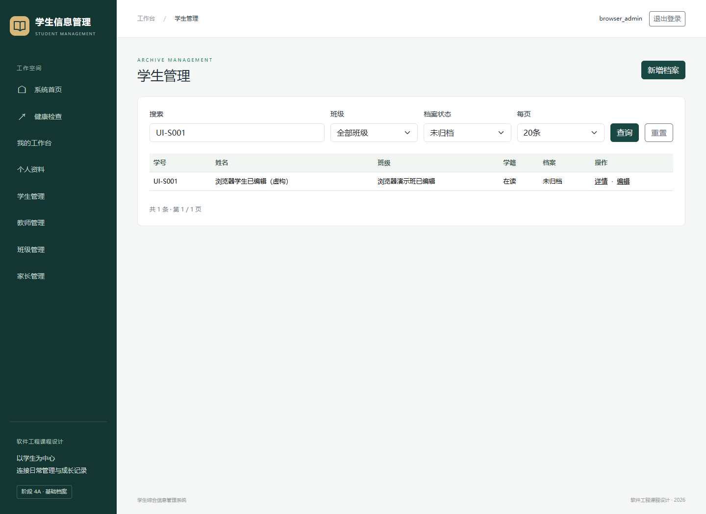

# 学生综合信息管理系统

基于 Python Flask 的软件工程课程设计。当前已完成**阶段 8 全系统测试、安全检查与 Windows 部署验收**。系统涵盖档案、教务成绩、成长记录、三角色工作台和管理员账号及审计。

数据库为 13 张领域表、94 个字段、20 个 RESTRICT 外键。阶段 8 复用已有迁移，并验证独立课堂部署与在线备份恢复。[阶段 8 验收报告](docs/reports/stage8_report.md)

## 安装和运行

课堂演示见 [Windows 部署](docs/deployment/windows_setup.md)，数据保护见 [SQLite 备份与恢复](docs/deployment/backup_restore.md)。下文的默认命令用于现有开发模式。

在 Windows PowerShell 中进入项目根目录：

```powershell
Set-Location 'F:\StudentManagementSystem'
py -3.12 --version
py -3.12 -m venv .venv
.\.venv\Scripts\python.exe -m pip install -r requirements.txt
.\.venv\Scripts\python.exe -m pip check
.\.venv\Scripts\python.exe run.py
```

解释器应显示 **Python 3.12.10**。不需要激活脚本；上面的命令始终使用项目 `.venv`，不会误用全局 Python 3.13。已存在并验证的 `.venv` 无须重复创建。

访问 [系统首页](http://127.0.0.1:5000/) 或 [健康检查](http://127.0.0.1:5000/health)。使用 Ctrl+C 停止。run.py 默认只监听本机 127.0.0.1:5000，关闭自动重载；当前开发配置 DEBUG=True。

开发环境可以通过环境变量配置会话签名密钥：

```powershell
$env:SECRET_KEY = .\.venv\Scripts\python.exe -c "import secrets; print(secrets.token_hex(32))"
.\.venv\Scripts\python.exe run.py
```

未设置 SECRET_KEY 时，每次创建开发应用生成临时随机密钥，重启后的旧会话/CSRF token 将失效。测试配置使用独立测试密钥，不读取开发环境密钥。不要把本地密钥写入版本文件。开发服务器仅供本机演示；已有环境无需重建虚拟环境或重建数据库。

## 实际验证的依赖

| 直接依赖 | 已验证版本 |
| --- | --- |
| Flask | 3.1.3 |
| Flask-SQLAlchemy | 3.1.1 |
| SQLAlchemy | 2.1.8 |
| Flask-Migrate | 4.1.0 |
| Alembic | 1.20.1 |
| Flask-Login | 0.6.3 |
| Flask-WTF | 1.3.0 |
| pytest | 9.2.0 |

[requirements.txt](requirements.txt) 固定上述依赖和传递依赖，共 22 项，版本来自本项目 Python 3.12.10 虚拟环境的实际安装与测试结果。前端采用本地 Bootstrap 5.3.3 CSS，不依赖 CDN、在线字体或前端构建工具；本阶段未使用需要 Bootstrap JavaScript 的交互组件。

## 测试

```powershell
.\.venv\Scripts\python.exe -m pytest -q
.\.venv\Scripts\python.exe -m flask --app run routes
```

阶段 1 历史实测：**19 passed**；[完整测试记录](docs/reports/stage1_pytest.txt)。测试覆盖工厂创建、首页、/health、403/404/500、静态资源、配置与数据库隔离、CSRF、有界路由及无业务库副作用。测试中的拒绝、异常和 POST 端点只在 tests 内创建，不存在于实际应用。

阶段2最终全套：**156 passed**，其中原19项继续通过；[阶段2历史测试记录](docs/reports/stage2_pytest.txt)、[阶段2验收报告](docs/reports/stage2_report.md)。数据库测试全部使用独立临时SQLite或内存库。

## 核心文件及职责

| 文件或目录 | 作用 |
| --- | --- |
| [app/__init__.py](app/__init__.py) | create_app(config_name="development", test_config=None)，先加载配置再初始化扩展、注册 Blueprint 和错误处理；不创建表 |
| [config.py](config.py) | 开发、测试、课堂演示及 HTTPS 部署配置，测试与默认课堂库独立 |
| [app/extensions.py](app/extensions.py) | db、login_manager、csrf、migrate；SQLite每连接开启外键 |
| [app/logging_config.py](app/logging_config.py) | 带时间、级别和应用名的控制台日志；不输出密钥或表单内容 |
| [app/errors.py](app/errors.py) | 注册 403、404、500 处理器，返回正确状态码与通用 HTML |
| app/auth、admin、students | 认证、管理员四类档案、账号和审计、最小本人资料，路由和 Service 校验权限 |
| app/academics、attendance、records | 课程、选课、成绩、考勤、奖惩、家长联系与模拟通知 |
| [app/dashboard/routes.py](app/dashboard/routes.py) | 公共首页/health、角色工作台分流及本人资料 |
| app/models、app/services | 13个SQLAlchemy2模型、UTC类型、SQLite保护触发器、验证/审计/模拟通知辅助服务 |
| [layout.html](app/templates/layout.html) | 共用导航、页头、内容区、页脚和本地资源引用 |
| app/templates/dashboard、errors | 首页与错误页面；错误页复用公共模板 |
| app/static | 自定义样式、品牌 SVG、本地 Bootstrap CSS |
| [run.py](run.py) | 本地开发及课堂启动。APP_ENV=demo 可配置端口，禁用调试器 |
| tests、[pytest.ini](pytest.ini) | 工厂/页面/数据库/迁移/服务/认证/权限回归，全部隔离测试数据库 |
| instance | 本机运行数据；阶段2以显式迁移建立 student_management.db，运行文件不纳入版本或源码交付 |
| [.gitignore](.gitignore) | 排除虚拟环境、缓存、敏感本地配置及运行数据库；保留 instance/.gitkeep |
| docs/specs、docs/uml | 阶段 0 设计基线与七类 UML 源文件 |
| [docs/specs/source](docs/specs/source) | 原始 Word；迁移后内容与 SHA-256 不变 |
| [阶段 1 报告](docs/reports/stage1_report.md) | 完整项目文件树、运行验收、截图、迁移证据和遗留问题 |

## 扩展及配置边界

Flask-Login 已接入真实 user_loader、current_user 与登录路由。每次请求按数据库账号启停、角色、档案校验和凭据版本恢复身份；不依赖固定role_id、不信任前端身份。公共首页及health在无账号会话时仍不建表或访问业务数据。

CSRF 在开发和测试配置中均启用。应用工厂只加载13模型及扩展，不调用create_all、建表或初始化账号；结构通过显式迁移升级。开发 URI 指向 `instance/student_management.db`，测试 URI 为 `sqlite:///:memory:`。/health 只说明应用能够响应，不代表数据库或业务模块就绪。

500 通用页面在异常由 Flask 错误处理器处理时生效。开发服务器 DEBUG=True 时，浏览器中的未处理异常可能由调试器展示；测试通过 PROPAGATE_EXCEPTIONS=False 验证通用 500 处理。应用没有专门触发 403/500 的生产路由。

完整设计及未决事项：[需求](docs/specs/requirements.md)、[架构](docs/specs/architecture.md)、[数据库](docs/specs/database_design.md)、[假设](docs/specs/assumptions.md)、[阶段 0 审查](docs/specs/design_review_report.md)。阶段2决策见 [stage2_decisions.md](docs/specs/stage2_decisions.md)，历史验收见 [阶段2报告](docs/reports/stage2_report.md)。本阶段完成后停止，等待下一阶段指令。

## 运行截图

下图为阶段 4A 本地运行的历史截图。阶段 8 的三角色及移动端截图收录于[验收报告](docs/reports/stage8_report.md)。



## 技术参考和资源来源

[Flask 应用工厂](https://flask.palletsprojects.com/en/stable/patterns/appfactories/)、[Flask-SQLAlchemy 配置](https://flask-sqlalchemy.palletsprojects.com/en/stable/config/)、[Flask-Login](https://flask-login.readthedocs.io/en/latest/)、[Flask-WTF CSRF](https://flask-wtf.readthedocs.io/en/1.2.x/csrf/)。集成接口同时按已安装版本的源码和实际测试核对。

Bootstrap 5.3.3 CSS 来自 [官方 npm 包分发资源](https://cdn.jsdelivr.net/npm/bootstrap@5.3.3/dist/css/bootstrap.min.css)，保留文件头 MIT 许可信息；SHA-256：`3C8F27E6009CCFD710A905E6DCF12D0EE3C6F2AC7DA05B0572D3E0D12E736FC8`。

## 阶段 2 数据库初始化

已有迁移脚本，不要重复运行 db init 或生成第二份初始迁移。新环境先安装固定依赖，再升级结构：

```powershell
.\.venv\Scripts\python.exe -m pip install -r requirements.txt
.\.venv\Scripts\python.exe -m flask --app run db upgrade
.\.venv\Scripts\python.exe -m flask --app run seed-roles
.\.venv\Scripts\python.exe -m flask --app run create-admin
# 可选：需要前一步已存在管理员，只生成虚构数据，不创建演示账号
.\.venv\Scripts\python.exe -m flask --app run seed-demo
.\.venv\Scripts\python.exe -m flask --app run db current
.\.venv\Scripts\python.exe -m flask --app run db check
.\.venv\Scripts\python.exe -m pytest -q
```

create-admin交互提示用户名及两次隐藏密码，Werkzeug哈希，无默认密码；重名拒绝。seed-roles及seed-demo可重复执行，不覆盖既有记录；演示标识使用DEMO命名空间，姓名和example.invalid联系方式均虚构。默认开发库本次仅迁移并初始化角色，未创建默认管理员或演示账号。测试中的管理员密码仅用于临时测试库，不是可登录的交付凭据。

时间均以UTC naive存储，界面以后再处理时区。归档不自动改变学籍或账号状态。审计快照递归去凭证、追加不可改删；审计及通知服务只add不commit，与调用方业务同事务提交。模拟通知只生成simulated记录，不调用短信/邮件服务。当前无审计查询界面，后续仅允许管理员授权查询。

临时工具或不同开发库可显式设置SMS_DATABASE_URI（影响development/production，testing保持隔离）；测试工厂使用独立临时instance与SQLite文件，不污染默认开发库。更新已有数据库前先保留备份，不删除或替换原库；本项目阶段2开始时不存在原数据库，本次是空库首次升级。初始downgrade会删除结构，仅用于丢弃式空库测试，不在既有数据上执行。

迁移以当前模型比较生成后人工审查，冻结SQL守卫在revision内；自定义UTC类型在迁移中使用标准DATETIME。参考 [Flask-Migrate](https://flask-migrate.readthedocs.io/en/latest/) 和 [SQLAlchemy SQLite外键](https://docs.sqlalchemy.org/en/20/dialects/sqlite.html#foreign-key-support)，实际行为以本项目迁移和测试验证为准。

## 阶段 3 使用与验收（历史）

已有数据库只需安装固定依赖并执行 `db check`，不要重新初始化迁移或清库。全新环境按前节显式 `db upgrade`、`seed-roles`、`create-admin`；没有交付默认密码。管理员、教师、学生工作台都依赖真实账号；教师和学生账号还必须绑定对应档案。首次管理员通过 CLI 创建。现行账号管理入口可创建并绑定教师和学生账号。截图账号来自临时验证库。

启动后访问 `/login`。`/dashboard`按数据库角色名称分流至管理员`/admin/`、教师`/dashboard/teacher`、学生`/dashboard/student`。`/profile`显示本人基础资料及改密入口；管理员从工作台进入“管理员密码重置”，输入目标用户名并重新验证管理员密码。`/logout`仅接受带CSRF的POST。

统一角色装饰器支持多角色。服务端按对象及动作限制访问，学生固定本人，教师依据当前班级与课程关系分别授权。

会话最长30分钟且不滑动续期；登录清旧状态，无remember-me。停用、删除、密码或角色绑定变化使原身份失效；学籍和归档不参与账号有效判断。本人改密/管理员重置沿用update审计，密码服务不commit，路由同事务提交。CSRF持续启用，凭据不进Cookie或普通日志；签名Cookie仅有ID、时间及不透明版本。退出清当前浏览器会话；复制Cookie的中心即时撤销需后续服务端会话设计。

production配置要求环境`SECRET_KEY`并开启Secure Cookie，供HTTPS部署准备，不代表本地Flask开发服务器可直接生产部署：

```powershell
$env:APP_ENV = 'production'
$env:SECRET_KEY = '<从本地安全配置提供的稳定随机密钥>'
# 根据实际HTTPS反向代理/WSGI部署运行；不要把密钥写进仓库
```

阶段3最终实测 **251 passed in 71.85s**，包含原156项与新增95项；[完整日志](docs/reports/stage3_pytest.txt)。`pip check`无依赖冲突，`db check`无结构差异。三角色真实浏览器交互、退出/403、本人数据范围及移动端布局通过；[浏览器结果](docs/reports/stage3_browser.json)。详细变更、安全设计、独立审查修复和后续边界见 [阶段3报告](docs/reports/stage3_report.md)。

## 阶段4A使用与验证

登录管理员工作台后，从真实入口进入学生、教师、班级和家长管理。页面支持搜索和分页；学生可按班级及归档筛选、查看详情/年龄/家长、编辑资料、办理已允许学籍迁移及独立归档恢复。教师详情只读展示当前班级/课程；班级可设置真实班主任并查看当前关联学生（含全部学籍及归档）。家长可按学生查询、新增/编辑、设置或取消主要联系人；同一学生最多一位主要。

主要地址为 `/admin/students`、`/admin/teachers`、`/admin/classes`、`/admin/parents`；家长写操作位于 `/admin/students/<student_id>/parents/...`，不可改变归属。普通学生编辑不改变status/is_archived或账号。所有写请求CSRF，服务再次校验管理员；SQLite写锁+刷新后再验证当前状态，业务与审计同事务，失败回滚。教师/学生管理接口403，原本人入口继续可用。

源码使用原13表94字段20外键，无新迁移。已有开发库无需重新初始化；新环境按前节显式db upgrade、seed-roles、create-admin创建自己的管理员。账号由管理员初始化或创建。档案删除策略、学籍状态例外和历史身份权限见最新设计规则。

阶段前测试251通过，修复后本机完整回归335通过（新增84项）；[实际测试日志](docs/reports/stage4a_pytest.txt)。[交付报告](docs/reports/stage4a_report.md)、[实施设计](docs/specs/stage4a_design.md)、[浏览器结果](docs/reports/stage4a_browser.json)。源码包在工作区外解压并建立新虚拟环境验证，实际结果以[解压验证](docs/reports/stage4a_extracted_validation.json)为准。源码交付排除运行数据库、虚拟环境、缓存、私人配置和临时凭据；测试常量只用于临时测试库，不是已创建的交付登录凭据。

## 阶段 4B 教师入口

有效教师账号登录后，从工作台打开“负责班级”或“授课课程学生”。班主任可看本班学生详情、只读家长联系方式，并保存学生电话与住址。任课名单仅有学号和姓名，按已有选课去重。空列表表示该教师当前没有对应班级或课程关联。开发库沿用既有迁移。

[权限规则与矩阵](docs/specs/stage4b_permissions.md) · [验收报告](docs/reports/stage4b_report.md) · [教师工作台截图](output/playwright/stage4b-workbench.png)

## 阶段 5 课程、选课与成绩

启动前可设置配置学期，默认演示值为 2026-Fall。已有数据库可继续使用。全新环境请先按上文运行迁移、初始化角色并创建管理员。

```powershell
$env:ACTIVE_SEMESTER = '2026-Fall'
& .\.venv\Scripts\python.exe -X utf8 run.py
& .\.venv\Scripts\python.exe -X utf8 -m pytest -q
```

- 管理员从工作台管理课程、分配授课教师并维护各学期选课与成绩。课程详情按学期查看选课人数，学生详情可打开该学生的选课和成绩记录。
- 教师可查看当前授课课程名单，为本班学生新增配置学期的本人授课课程，并录入或修改本人课程在配置学期的成绩。
- 学生从工作台查询已选课程、选课记录和本人各学期成绩。分数区分“未评分”和 0 分。

[阶段 5 业务规则与权限矩阵](docs/specs/stage5_decisions.md) · [阶段 5 验收报告与截图](docs/reports/stage5_report.md)

## 阶段 6 考勤、奖惩与家长联系

- 管理员通过工作台查看、维护全校记录。教师工作台为当前班主任提供本班管理入口。学生通过“本人考勤”查询个人记录与出勤统计。
- 出勤率计算计入出勤及迟到，请假单列。无可统计分母时显示“无可统计数据”。
- 在“模拟通知”中显式创建本地短信或邮件记录。家长联系与通知分别保存，通知详情注明“模拟通知，未实际发送”。

[阶段 6 业务规则](docs/specs/stage6_decisions.md) · [阶段 6 验收报告与截图](docs/reports/stage6_report.md)

## 阶段 7 管理员与统计入口

- 管理员使用“用户管理”创建、编辑、绑定、启用或停用账号，使用“审计日志”筛选和查看脱敏操作历史。首次管理员仍由上文的 CLI 显式初始化。
- “首页统计”按角色展示数据库汇总。管理员可切换成绩学期及考勤班级，教师分开查看当前班级与本人课程，学生仅查看本人。
- 近期考勤按 UTC 最近 30 日。成绩均值只计算选定学期内三项成绩齐全的记录。移动端通过顶部“功能菜单”打开导航。

[阶段 7 设计决策](docs/specs/stage7_decisions.md) · [阶段 7 验收与截图](docs/reports/stage7_report.md)

## 阶段 8 部署和交付

- 课堂运行使用 APP_ENV=demo。本机 HTTP 回环监听，禁用调试器，自动生成临时密钥。
- 在线备份脚本生成独立 SQLite 文件并检查数据完整性，可恢复至另一个实例。
- 验收报告包含全量回归、三角色浏览器流程、安全审查和真实截图。

[Windows 部署](docs/deployment/windows_setup.md) · [备份与恢复](docs/deployment/backup_restore.md) · [安全审查](docs/reports/stage8_security_review.md) · [阶段 8 验收](docs/reports/stage8_report.md)

## 阶段 9 课程设计交付

[最终报告](docs/final/软件工程课程设计报告_学生综合信息管理系统.docx) · [验收与提交说明](docs/reports/stage9_report.md) · [证据清单](docs/final/evidence_inventory.md) · [视频演示脚本](docs/final/视频演示脚本.md)
